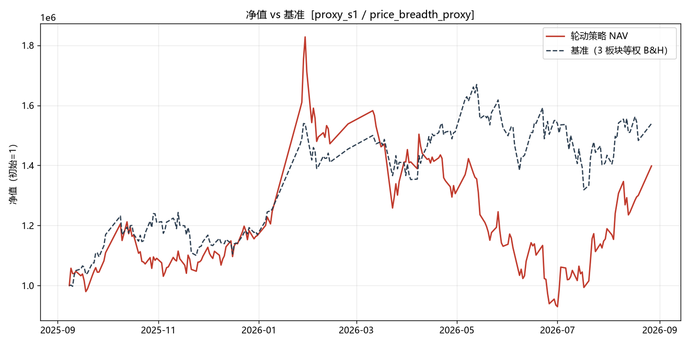
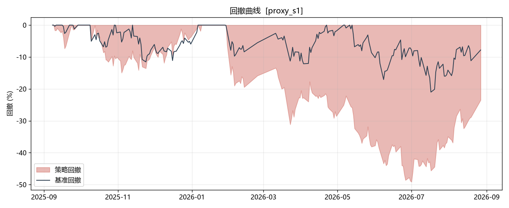
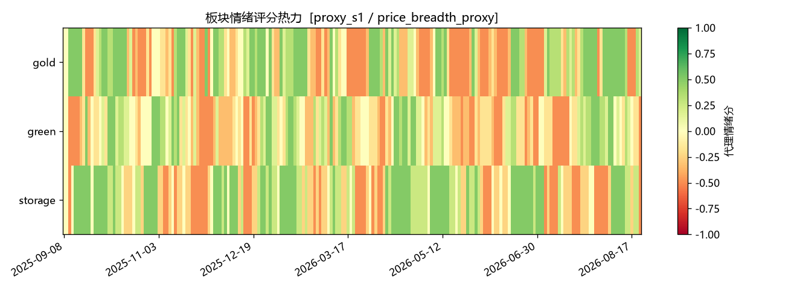

# 板块轮动回测报告（BACKTEST_REPORT）

生成时间: 2026-10-14 10:38

> 数据诚实性：本报告严格区分**真实 LLM 情绪（llm_news_replay）**与**代理情绪（price_breadth_proxy）**，代理结果仅用于机制与成本链路验证，不作为结论性业绩。

## 1. 概述

- 价格窗口 W_price：2025-09-08_2026-08-27（208 交易日，等权成分）
- W_real（真实新闻可回溯公共窗口）：**空窗**（各票新闻回溯区间无重叠，见 DATA_FEASIBILITY §3），S2 降级为前向累积观察
- 三场景：S1 代理全窗口 / S2 真实情绪 / S3 参数敏感性

## 2. 指标表（含基准对比）

| 场景 | sentiment_source | 交易日 | 总收益 | Sharpe | 最大回撤 | 轮动次数 | 成本占比 | 基准收益 | 基准Sharpe | 基准回撤 |
|---|---|---|---|---|---|---|---|---|---|---|
| proxy_s1 | price_breadth_proxy | 208 | +39.82% | 0.9623 | 49.15% | 0 | 0.0000% | +53.91% | 1.43 | 21.01% |

注：S1 为代理情绪，其收益/回撤仅验证链路，不代表真实策略业绩。

### S2 状态

S2（真实 LLM 情绪 × W_real）因真实新闻窗口为空而**降级为前向累积观察**，本次不产出结论性指标。由每日任务累积真实情绪序列后重跑。

## 3. 逐笔轮动复盘

### S1（代理情绪）

本场景无被接受的轮动：代理情绪为板块内截面标准化分数，最高分恰为 0.5，而候选门槛要求严格大于 0.5（`MIN_TARGET_SENTIMENT`），默认阈值下候选轮动永不触发；初始已持有防御板块 gold，亦无下沉触发条件。

## 4. 参数敏感性（S3，代理情绪 × W_price）

| decline_threshold | target_threshold | cooldown | 轮动次数 | 总收益 | Sharpe | 最大回撤 | 成本占比 |
|---|---|---|---|---|---|---|---|
| -0.2 | 0.5 | 7 | 0 | +39.82% | 0.9623 | 49.15% | 0.0000% |
| -0.3 | 0.5 | 7 | 0 | +39.82% | 0.9623 | 49.15% | 0.0000% |
| -0.4 | 0.5 | 7 | 0 | +39.82% | 0.9623 | 49.15% | 0.0000% |
| -0.3 | 0.3 | 7 | 5 | +26.71% | 0.7601 | 57.39% | 2.3253% |
| -0.3 | 0.4 | 7 | 5 | +26.71% | 0.7601 | 57.39% | 2.3253% |
| -0.3 | 0.5 | 7 | 0 | +39.82% | 0.9623 | 49.15% | 0.0000% |
| -0.3 | 0.5 | 5 | 0 | +39.82% | 0.9623 | 49.15% | 0.0000% |
| -0.3 | 0.5 | 7 | 0 | +39.82% | 0.9623 | 49.15% | 0.0000% |
| -0.3 | 0.5 | 10 | 0 | +39.82% | 0.9623 | 49.15% | 0.0000% |

结论：候选轮动仅在 `target_threshold` 下修至代理分数可达区间（≤0.5）时才被触发，印证代理情绪为截面相对分数、不具备绝对景气水平含义；这正是必须用真实 LLM 情绪（S2）才能支撑结论的原因。

## 5. 覆盖门槛判定

**未达覆盖门槛（S2 数据不足）**：真实 LLM 情绪历史为空窗（见 DATA_FEASIBILITY §3/§6），无法确认轮动相对基准的实质性提升，故**不将轮动结果写入 `docs/data/` 供前端消费**，保留稳定基准；待 `daily_job` 的 `history.jsonl` 累积 ≥20 个交易日真实情绪后重跑 S2。

## 6. 数据与局限性声明

- 详见 [DATA_FEASIBILITY.md](docs/sector_rotation/DATA_FEASIBILITY.md)。
- 交易日历按 weekday<5 近似，未含法定节假日调休。
- 代理情绪为价格截面标准化 + 涨跌家数宽度，非真实新闻情绪，禁止标注为 LLM 情绪。
- 个股日频真实情绪历史在本仓库不存在，S2 需前向累积后重跑。

## 7. 图表

