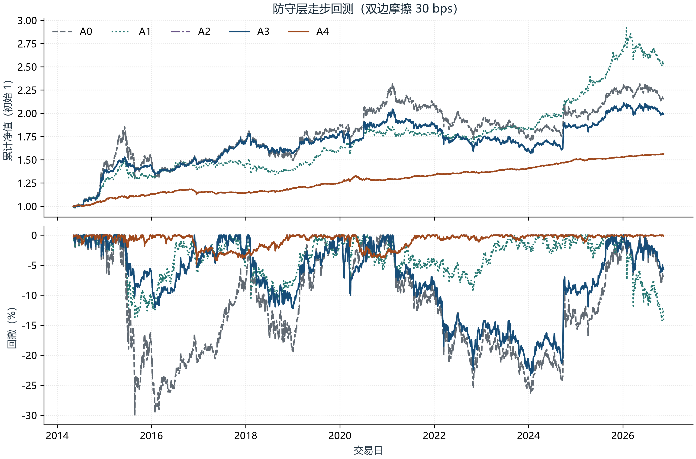
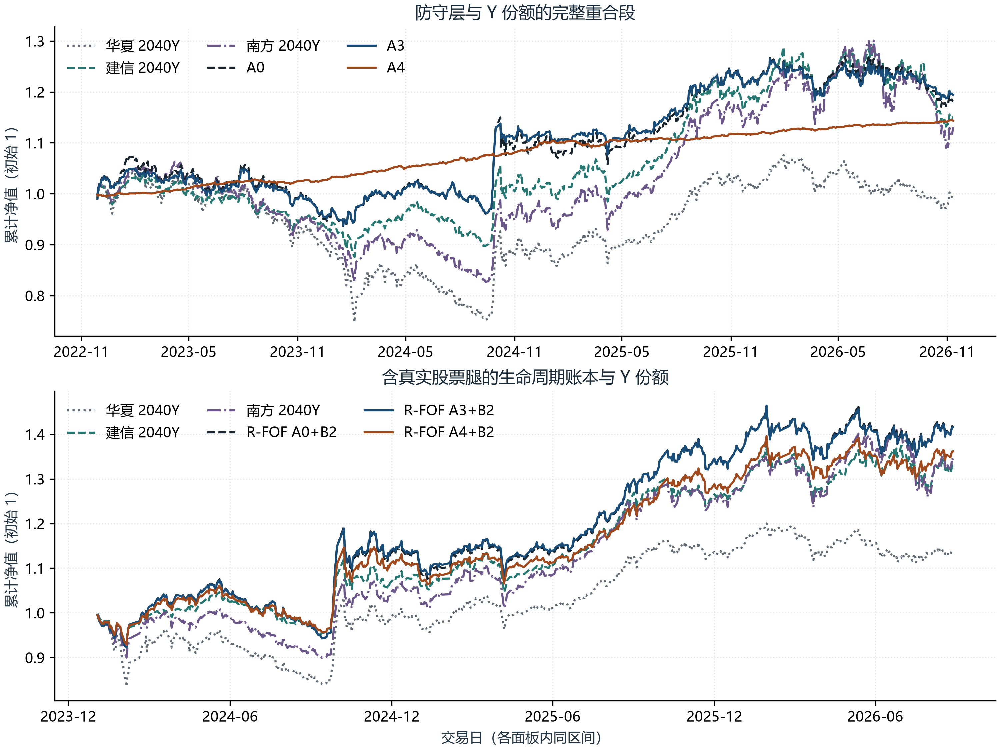
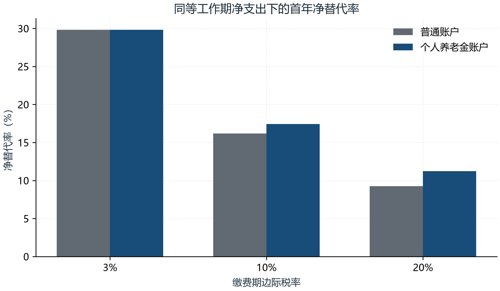
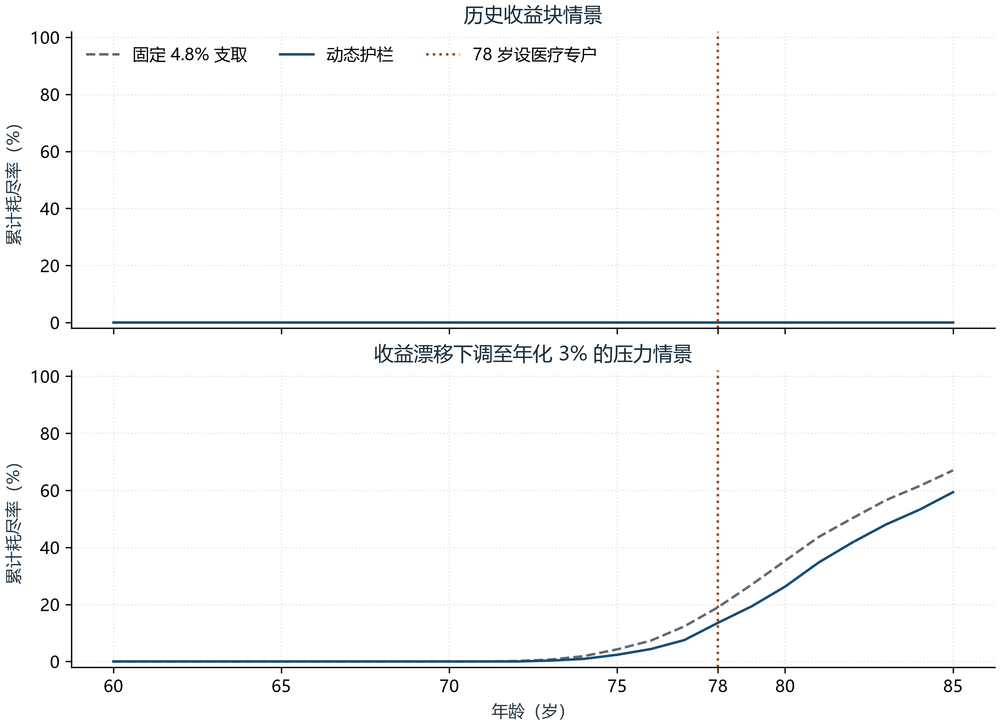

# R-FOF 资产与退休支取分析

本轮使用 GitHub [Issue #12](https://github.com/YuxuanWuCN/stock-dashboard/issues/12) 指定的 main 基线 06bd5ed。行情采集截止 2026-11-13。按上一轮三准则，**A1 和 A3 在防守层通过，A4 未通过**。A4 的风险较低，但 8% 波动目标未触发任何降仓，结果与 A2 重合。真实股票腿、期货和 Y 份额的共同窗口为 2024-01-03 至 2026-08-28。

## 数据和分红

- **股票腿。** 使用仓库 CSMAR 主表的 192,199 行、299 支股票、644 个交易日，覆盖 2024-01-02 至 2026-08-28。A 组 99 支使用 CSMAR 已申报含息收益 Dretwd，B/C 各 100 支使用其声明的前复权收盘比值。63,399 行为申报收益，128,600 行为复权收盘变动，另有 B/C 首日 200 行无法计算变动。C 组原始导出缺少，证据低于 B 组。股票腿按上一交易日可交易的标的按月等权，其间自然漂移。357 个缺失股票日保持持仓估值，无法交易的权重留在原标的。账本记录当日缺估值权重，均值 0.177%，单日最高 1.696%。样本股票池事后固定，且中国重工吸收合并未逐笔模拟，存在选择偏差与残余估值误差。
- **ETF 防守池。** 沿用 10 只标的 510050、510300、159915、588000、512660、512880、515030、515790、518880、511010。采用新浪未复权成交收盘和天天基金分红及折算表，逐日用（收盘价 × 折算比例 + 每旧份现金）/ 前收盘价 − 1。修复后的 510300 为沪深 300 ETF 的实盘价格基准。模型在除息日收盘再投资，实际红利发放有时间差。使用上市后的可见数据训练。159915 有 1 个市场交易日缺收盘，当日按前收估值，下一观测日记录累计变动。10 只中有 3 只有测试期内现金分红，其余按披露零派息处理。历史防守池资格沿用上一轮数据审计，个人养老金账户产品准入以监管名录为准。[510300 基本信息](https://www.sse.com.cn/assortment/fund/list/etfinfo/basic/index.shtml?FUNDID=510300)
- **现金与红利复核。** 银华日利 511880 的现金腿使用份额净值加分红。2025-12-30 净值扣减每份 1.1553 元，公告给出的场内除息日是次日。市场收盘序列只用于价格涨幅对照。同区间 2013-04-18 至 2026-11-13，511880 价格涨幅 0.89%，净值含息再投累计 +39.89%。红利 ETF 510880 作为额外审计样本，2010-01-04 至 2026-11-13 的价格涨幅 21.50%，含息 +115.47%。510300 全可用区间含息 +98.47%，价格 +56.80%。可手算核对 510300 在 2026-01-19 除息每份 0.123 元。[银华日利分红公告](https://www.sse.com.cn/disclosure/fund/announcement/c/new/2025-12-26/511880_20251226_IIQW.pdf) · [510300 分红公告](https://www.sse.com.cn/disclosure/fund/announcement/c/new/2026-01-12/510300_20260112_VTCZ.pdf) · [510880 基本信息](https://www.sse.com.cn/assortment/fund/list/etfinfo/basic/index.shtml?FUNDID=510880)
- **Y 份额。** 选择同为目标日期 2040、三年持有期的华夏 017247、建信 017258、南方 017377，均在证监会 2026-09-30 名录内。分销商最近可核净值日为 2026-11-11，三只均显示开放申购。管理费和托管费已反映在净值中，历史净值按每份现金分红再投资。对标表另列小额申购合同费率的单次入场敏感性。渠道折扣随时间变化，三年锁定和个人养老金账户领取条件需要一并考虑。[证监会名录](https://www.csrc.gov.cn/csrc/c101900/c6551799/content.shtml) · [华夏费率](https://www.chinaamc.com/fund/017247/jijinfeilv.shtml) · [建信 2026-09-24 产品资料概要](https://www.etf88.com/jjb/2026/0924/9936601.html) · [南方费率](https://www.nffund.com/new/personal-financing/detail.html?fundCode=017377)

原始行情读取端点、快照及产物 SHA-256 见 [运行清单](run_manifest.json)。逐只分红数、起止日期及最大单日波动见 [ETF 审计表](tables/etf_data_audit.csv)，Y 基金 [产品和费率](tables/fund_products.csv) 与 [历史净值](tables/tdf_daily_nav.csv) 单独提供。

## 防守层与产品对照

防守层 3,047 个交易日，区间 2014-05-06 至 2026-11-13。季度首个交易日用 t-1 及以前的信息定权重。A0 配置 36% 国债 ETF、40% 上证 50 ETF、24% 沪深 300 ETF。A1 使用 Ledoit–Wolf 收缩协方差和 40% 单标的上限，A2 使用 HRP。A3 在 A0 外加 8% 波动率目标，A4 在 A2 外加同一目标。动态资产至少有 252 个观测日，主估计窗最多 756 日，过去 60 日估计配置组合波动。风险权重乘 min(1, 8% / 历史年化波动)，剩余投向 511880。另测 504 日估计窗、6% / 10% 目标和 15 bps 交易摩擦。持仓按净值漂移，波动目标随季度更新。

30 bps 主口径按换手计费，从初始净值 1 计算最大回撤。超额日收益用现金腿，夏普为超额日收益均值除以样本标准差再乘 √252。

| 方法 | 年化收益 | 年化波动 | 最大回撤 | 夏普 | 优于 A0 的窗口 | 门禁 |
|---|---:|---:|---:|---:|---:|---|
| A0 | 6.53% | 13.60% | −30.07% | 0.358 | 基准 | — |
| A1 | 7.91% | 8.44% | −14.23% | 0.661 | 3 / 4 | 通过 |
| A2 | 3.75% | 2.34% | −4.84% | 0.565 | 4 / 4 | 未过收益线 |
| A3 | 5.86% | 9.21% | −23.34% | 0.405 | 4 / 4 | 通过 |
| A4 | 3.75% | 2.34% | −4.84% | 0.565 | 4 / 4 | 未过收益线 |

三准则为 4 个预设窗口至少赢 3 个、全样本回撤改善至少 2 个百分点且参数中位数仍优、30 bps 下相对 A0 年化收益拖累至多 1 个百分点。A4 对 A0 的回撤改善为 25.22 个百分点，收益拖累 2.78 个百分点。A4 对 A3 的回撤改善为 18.50 个百分点，63 日配对块 bootstrap 的探索性 95% 区间为 6.09 至 29.64 个百分点。其年化收益差为 −2.11 个百分点，区间 −8.73 至 3.73。区间基于 800 次双边同一交易块抽样，21 日和 63 日各跑一次，未做多重比较校正。门禁是预定经营阈值，置信区间衡量样本敏感性。[逐窗口结果](tables/defense_method_results.csv) · [门禁](tables/stability_verdict.csv) · [区间表](tables/paired_block_comparison.csv)

上一轮脚本用 15 bps 档出裁决表，本轮按三准则的原始说明用 30 bps 裁决。上一轮 30 bps 归档的 A0 / A3 是 4,509 日，年化收益 0.10% / 2.29%，最大回撤 −57.80% / −26.53%，夏普 −0.116 / −0.014。归档输入、起点及计量公式和本轮有差别，直接比较无法归因。为测口径敏感性，对同 3,047 日用价格收益和 2.4% 常数现金再跑。A0 / A3 年化收益 5.27% / 4.84%，最大回撤 −30.07% / −24.46%，夏普 0.270 / 0.301。归档数据与基准产物保留。[上一轮表](../../rfof_stability_20261108/reports/tables/defense_method_results.csv) · [本轮价格口径重跑](tables/price_only_replay.csv)

Y 份额对比有两段。ETF 防守层和 3 只 Y 份额的重合段为 2022-11-28 至 2026-11-11，共 958 日。加入股票与期货的重合段为 2024-01-03 至 2026-08-28，共 643 日。后一段 A3+B2 / A4+B2 年化 14.60% / 12.86%，最大回撤 −12.18% / −9.87%。三只 Y 的年化分别为 5.19%、11.61%、12.17%，最大回撤为 −16.51%、−8.89%、−10.97%。同区间 510300 年化 15.73%，最大回撤 −16.25%。各自风险预算、持有约束和底层费用不同，短窗口的净值对比不能推断长期优胜。[同区间对标表](tables/tdf_comparison.csv)

## 期货摩擦与逐日账本

AU/M/CU 保留 50%/25%/25%，新浪主力连续收盘计算日变动，t-1 高于 MA20 时持有该腿，其余在 511880。B1 在激活仓位上按每次 20 bps、6 次/年日摊展期成本。B2 同时扣 B1 并在 15% 名义保证金假设下给 85% 未占用资金计现金腿收益。B0/B1/B2 期货腿年化分别为 14.73% / 13.89% / 14.69%，接回 A3 后分别为 14.61% / 14.49% / 14.60%。主力连续报价含切换跳点，展期和保证金是模型参数，成交价差、逐合约换月和券商利息没有实盘复现。[期货对比](tables/futures_comparison.csv) · [逐日摩擦](tables/futures_variants.csv)

研究账本用 35 岁的配置起点，60 岁配置用于退休历史路径。按已披露的非对称驼峰与季度单向棘轮规则，超出成长仓季度 6% 的利润提取 50% 划入防守。研究示例的成长权重下限 20%、峰值 70%、峰值年龄 35，峰值左右宽度分别是 10 / 12 岁，成长中权益和期货按 80% / 20%。季度按年龄上限单向补防守，底仓无倒流。账本扣除股票、ETF 和外层的换手摩擦，以及研究版 FOF 0.5%/年外层费用。高斯参数和逐日基线文件未随本仓库提供，以上配置用于研究账本，旧账本和原始策略还需有原件才能逐日对账。[上一轮规则披露](../../rfof_stability_20261108/reports/R-FOF系统理论依据与答辩全景攻防手册_两组员融合终极版.md)

Issue #13 可读取 [daily_ledger.csv](tables/daily_ledger.csv)。主键是 trade_date 和 strategy_id，net_return 和权重用小数，nav 用各策略起始单位基准。RFOF_A3_B2 与 RFOF_A0_B2 用于同区间策略分析，RFOF_A4_B2、三个六位 Y 代码和两个基准 ETF 也已导出。应用方应保留代码前导零，对各自的共同起算日净值重基，或直接连乘 net_return。账本的股债期货权重、成本、棘轮划转额及 trend_gate_closed 可用于断缴或回撤情境。表内日收益来自实证输入，断缴和行为分析需要由 #13 另行建模。

## EET 税后净替代率

个人养老金缴费扣除以 12,000 元/年为限，投资环节暂不征收个人所得税，领取环节单独按 3%。设 30 年年末缴费，按同等工作期净支出比较。养老金账户每年投 12,000 元，普通账户投入 12,000 元减当年节税额，两者使用相同的费用后收益率假设。税前替代率以首年税前领取额除以税前工资，净替代率以领取净额除以扣个税后的退休前工资。普通账户投资收益和支取按此模型的净额口径，不加另一层税。工作期计税基数分别为 3 万、10 万、20 万元，扣缴前后均在各档内。工资仅计 6 万基本费用扣除。跨档用累进税函数按前后税额算差额。[个人养老金税收公告](https://fgk.chinatax.gov.cn/zcfgk/c102416/c5237110/content.html) · [综合所得税率](https://www.samr.gov.cn/zw/zfxxgk/fdzdgknr/bgt/art/2023/art_901ca8faba104739bbf54e22483e6079.html)

以两账户净名义收益均为 3%、首年支取率 4.8% 为例，个人养老金账户积累约 57.09 万元。

| 边际税率 | 年节税 | 普通账户净替代率 | EET 净替代率 | 净增益 |
|---|---:|---:|---:|---:|
| 3% | 360 元 | 29.83% | 29.83% | 0.00 个百分点 |
| 10% | 1,200 元 | 16.17% | 17.43% | 1.26 个百分点 |
| 20% | 2,400 元 | 9.25% | 11.22% | 1.97 个百分点 |

完整 [EET 表](tables/eet_net_replacement.csv) 含税前、税后、0%/3%/5% 收益假设。不同税档对应不同收入水平，净增益应在同一行内比较。

## 60–85 岁支取

两套方案使用同一条配对模拟收益路径，以 57.09 万元退休余额开局，60 到 85 岁每年年首支取，共 26 次。固定方案从初始余额的 4.8% 起按 2% 通胀递增。动态方案在该年首日抽中历史下行门控时，将当年计划生活支取降至 80%。门控复用仓库 20 日动量和 60 日均线函数，使用该历史交易日前已知的 510300 含息信息。78 岁后的医疗预算对两组相同，年首按退休初始余额的 1.2% 及通胀折算。动态组在 78 岁将当时账户的 20% 内部划入医疗专户，专户按 511880 收益滚存、优先支付医疗，余额受限。医疗比例是情景假设，等待 #13 的老年支出数据校准。以 85 岁末两账户合计余额为零判耗尽，同时计未支付预算和累计实际税后支取。

使用 642 个真实账本交易日去掉初次建仓日，按 63 或 126 日的连续块抽样，保留块内先后顺序。每个情景运行 2,000 条配对路径，固定随机种子 20261112。压力测试把首块锁定为样本最低累计收益块、将医疗预算翻倍，或将组合历史对数收益漂移调到年化 3%。后者保留样本波动，代表模型情景。

| 情景 | 固定 4.8% 的 85 岁耗尽率 | 动态护栏的 85 岁耗尽率 |
|---|---:|---:|
| 历史 63 日块 | 0 / 2,000 | 0 / 2,000 |
| 历史 126 日块 | 0 / 2,000 | 0 / 2,000 |
| 首块为历史最差 63 日 | 0.15% | 0.05% |
| 医疗预算翻倍 | 0.15% | 0.05% |
| 长期名义漂移为 3% | 67.00% | 59.35% |

3% 情景下，耗尽率下降 7.65 个百分点，配对模拟标准误 0.59 个百分点。至少一年医疗预算短供从 63.10% 降到 55.50%。中位累计实际税后生活支取却从 61.02 万元降到 60.61 万元，反映降低耗尽和当期生活支出的取舍。历史样本仅约 2.6 年，模拟零耗尽仅表示这些抽样路径内未观察到事件，无法外推为退休风险接近零。[耗尽指标](tables/retirement_ruin.csv) · [逐年龄分布](tables/retirement_age_profile.csv)

## 复现与审阅

在仓库根目录运行以下命令。行情首次采集访问文档列出的公开端点。获得的本地快照在 data/_raw_cache/rfof_issue12，行情修订后重新采集可能生成新哈希。复现使用原快照并逐文件校验。输出目录使用新路径，避免覆盖已有账本。作图需要可用中文字体，复算 CSV 可以加 --no-plots。

~~~powershell
$study = "research-outputs/rfof_next_cycle/member1_asset_quant"
python -m pip install -r "$study/requirements.txt"
python "$study/fetch_market.py"
python "$study/run_study.py" --output work/rfof-issue12-review
python -m pytest -q tests/test_rfof_asset_quant.py
~~~

#14 的 DuckDB 接口尚未合入。默认用本地 DuckDB 内存连接读主表 Parquet 和四个行情快照。外部接入可传 --reader module:factory，工厂接受 root 和 market_dir 关键字参数，返回实现 stock_panel、etf_closes、fund_navs、actions、futures_closes 的对象。真实 #14 入口及输出字段需要合入后联调。当前只验本地连接和适配契约。

## 独立复核

- 用 Parquet 复查 299 支、644 日和 192,199 个唯一股票日键。用首两日持仓和源收益手算首日 −0.30732%（含建仓成本）。
- 公告与原始快照交叉核对后，510300 除息收益为 (4.738 + 0.123) / 4.859 − 1 = 0.04116%。511880 的净值扣息日收益为 (100.0442 + 1.1553) / 101.1966 − 1 = 0.00287%。
- 从导出的净收益独立逐日连乘，复算 A0/A3/A4 年化和最大回撤。A2/A4 的 3,047 个日收益逐项相同，A4 的 511880 权重全为 0。期货 B1/B2 的每日扣费和闲置资金收益也逐项对齐。
- 用年金公式复核节税和终值。3% 漂移压力测试中，固定/动态分别耗尽 1,340/1,187 条路径，分母各 2,000。医疗专户的内部划转和两组医疗开支一致性另有手算用例。
- 复跑的 14 张 CSV 各自 SHA-256 一致。4 张 PNG 以 300 DPI 导出并目视检查了中文标签、坐标和曲线。逐日账本有 17 个序列、29,428 行，日期和策略键无重复。

## 工程门禁

Issue #12 的 13 项专项测试均通过。质量 CLI 按 small、medium、heavy 顺序执行。small 和 medium 通过。heavy 的股票可复现性测试通过，全仓 pytest 为 1,499 通过、13 失败，秘密扫描命中旧测试中的令牌形态夹具。

在相同运行环境、无本轮改动的 06bd5ed 检出中单独复跑，13 个 pytest 失败项和秘密扫描命中均复现。测试失败包括旧因子溯源哈希、缺 FastEmbed、缺 PC5 固定输入、板块相关性响应字段缺失、SQLite 因子表缺失和旧 K 线长度断言。具体门禁记录为 20261116130353-heavy-ce1c86。未将这些全仓问题纳入本次资产实验变更。
