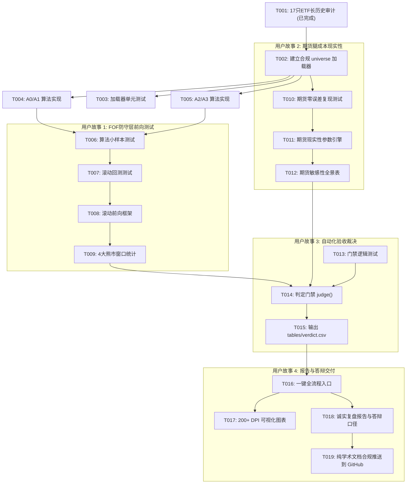

# 任务：022-fof-stability-futures-realism

**输入**：来自 `specs/022-fof-stability-futures-realism/` 的设计文档  
**先决条件**：plan.md（已完成），spec.md（已完成），research.md（已完成），data-model.md（已完成），contracts/stability_outputs.md（已完成）  
**组织**：任务严格按用户故事组织，遵循测试先行原则，保证各故事可独立实现与验证。

## 格式：`[ID] [P?] [故事] 描述`

- **[P]**：可并行运行（不同文件，无依赖关系）
- **[故事]**：[US1] 防守层滚动对比, [US2] 期货腿成本现实性, [US3] 自动化验收裁决, [US4] 诚实报告与答辩口径

---

## 阶段 1：设置与输入检查（共享基础设施）

**目的**：确保多资产数据加载健全性与异常跳变拦截能力

- [x] T001 [P] 在 `R-FOF/tools/stability_etf_audit.py` 中完成 17 只 ETF 历史长序列（2012–2026）覆盖率与异常跳变审计，输出 `reports/stability_20261108/tables/etf_data_audit.csv`
- [ ] T002 在 `R-FOF/tools/stability_universe.py` 中实现核心数据加载器 `load_universe()`，内置涨跌停与折算异常检测器 `detect_jumps()`，严格排除 6 只有除权跳变缺陷的 ETF，锁定 10 只合格池（510050, 510300, 159915, 588000, 512660, 512880, 515030, 515790, 518880, 511010）
- [ ] T003 [P] 在 `R-FOF/tests/test_stability_universe.py` 中编写候选池加载与坏数据拦截单元测试（验证正常加载、跳变抛错及日期列严格对齐）

---

## 阶段 2：基础模型与算法实现（阻塞先决条件）

**目的**：实现核心资产配置与风险控制算法库（必须有针对小样本的数学核对断言）

- [ ] T004 [P] 在 `R-FOF/tools/stability_methods.py` 中实现基准 A0 规则（现金36% + 红利40% + 宽基24% 及均线防守）与 A1（基于 `sklearn.covariance.LedoitWolf` 协方差收缩的最小方差权重分配，支持 40% 资产上限）
- [ ] T005 [P] 在 `R-FOF/tools/stability_methods.py` 中实现 A2（López de Prado 层次风险平价 HRP 树状聚类与准对角化逆方差分配）及 A3（无杠杆 8% 波动率目标动态现金缩放）
- [ ] T006 [P] 在 `R-FOF/tests/test_stability_methods.py` 中编写算法小样本单元测试（验证 A1/A2 权重非负且和为 1、HRP 在 3 资产对称样本上的数值闭式解、A3 杠杆严格 ≤ 1.0）

**检查点**：基础算法与测试已通过，可以独立展开用户故事回测

---

## 阶段 3：用户故事 1 - FOF 防守层长历史滚动前向回测 (优先级: P1) 🎯 MVP

**目标**：在 2012–2026 长历史样本与 4 大历史极端熊市窗口中，严格无前视对比 A0/A1/A2/A3 的最大回撤、年化波动与换手摩擦

**独立测试**：运行 `python -m pytest R-FOF/tests/test_stability_walkforward.py`，确认追加未来数据不改变历史权重，且 4 个熊市窗口能产出完整指标矩阵。

### 用户故事 1 的测试
- [ ] T007 [P] [US1] 在 `R-FOF/tests/test_stability_walkforward.py` 中编写前视偏差（Look-ahead Bias）隔离测试与极端熊市切片区间测试

### 用户故事 1 的实现
- [ ] T008 [US1] 在 `R-FOF/tools/stability_walkforward.py` 中实现滚动前向框架 `run_walkforward()`（固定 3 年训练窗、按季首日再平衡、t-1 日收盘信息集隔离、15bps 双边换手摩擦扣除）
- [ ] T009 [US1] 在 `R-FOF/tools/stability_walkforward.py` 中实现 4 大熊市窗口统计器 `window_metrics()`（2015-06~2016-02, 2018, 2021-12~2022-10, 2025-09~2026-10），计算全样本及各窗口 MaxDD、Vol、IRR、Turnover

**检查点**：用户故事 1 可独立运行并输出 `tables/defense_method_results.csv`

---

## 阶段 4：用户故事 2 - 期货对冲腿现实性与成本敏感性 (优先级: P1)

**目标**：补齐商品期货对冲腿在真实市场中的展期摩擦、保证金现金补偿、均线灵敏度与休市对齐，彻底消除“理想化无成本”质疑

**独立测试**：运行 `python -m pytest R-FOF/tests/test_stability_futures.py`，验证 B0 严格 100% 逐日复现基线 `r_futures_hedge`，且 B1~B4 参数网格损耗方向逻辑自洽。

### 用户故事 2 的测试
- [ ] T010 [P] [US2] 在 `R-FOF/tests/test_stability_futures.py` 中编写基准 B0 复现零误差断言（与既有 `precomputed_core_returns.csv` 误差 < 1e-9）及展期成本单调性测试

### 用户故事 2 的实现
- [ ] T011 [US2] 在 `R-FOF/tools/stability_futures.py` 中实现期货多维现实性回测函数 `futures_variant()`，支持 B0（基线复现）、B1（换月展期拖累网格 0/5/10/20 bps × 换月频次）、B2（10%/15% 保证金及闲置资金现金回报补偿）、B3（MA 10/20/40/60 均线敏感性）、B4（交易日历真实休市对齐，替代 ffill）
- [ ] T012 [US2] 在 `R-FOF/tools/stability_futures.py` 中生成期货敏感性全景参数对照表，输出 `tables/futures_sensitivity.csv`

**检查点**：用户故事 2 产出完整的期货对冲腿成本与抗风险区间

---

## 阶段 5：用户故事 3 - 自动化三原语验收裁决门禁 (优先级: P1)

**目标**：依据 spec 预先锁定的三条量化及格线自动判定是否有显著改善，杜绝事后挑参

**独立测试**：运行 `python -m pytest R-FOF/tests/test_stability_verdict.py`，验证在全达标与不达标假数据下判定逻辑均严密有效。

### 用户故事 3 的测试
- [ ] T013 [P] [US3] 在 `R-FOF/tests/test_stability_verdict.py` 中编写判定逻辑单元测试（构造正反测试样例，验证三准则联合通过才亮绿灯）

### 用户故事 3 的实现
- [ ] T014 [US3] 在 `R-FOF/tools/stability_verdict.py` 中实现 `judge()` 函数，自动比对每个改进方案与基准 A0：
  - 准则 1：4 大熊市窗口中至少 3 个最大回撤小于 A0
  - 准则 2：全样本最大回撤改善 ≥ 2.0 pp，且参数网格中位数仍优于 A0
  - 准则 3：在 30 bps 换手摩擦下，年化收益相对 A0 损耗 ≤ 1.0 pp
  - 最终状态：三条全过标记 `improved`，任一未过标记 `no_significant_improvement`
- [ ] T015 [US3] 输出标准判定明细表 `tables/verdict.csv`

**检查点**：自动化判决门禁就绪，产出无偏见机器裁决

---

## 阶段 6：用户故事 4 - 一键流水线、诚实实证报告与答辩口径 (优先级: P2)

**目标**：统筹全流程一键输出所有图表与综合报告，并生成大创/答辩专用的直面质疑说辞

- [ ] T016 [US4] 在 `R-FOF/tools/run_stability_study.py` 中组装端到端运行流水线（参数配置 -> universe -> methods -> walkforward -> futures -> verdict -> report），带输出目录防覆盖保护
- [ ] T017 [US4] 生成出版级 300 DPI 净值与水下回撤对比图 `figures/fig_defense_comparison.png` 及期货成本敏感性箱线图 `figures/fig_futures_sensitivity.png`（配置中文字体 SimHei/Microsoft YaHei 兼容）
- [ ] T018 [US4] 撰写最终《FOF防守层稳定性与期货现实性实证复盘报告》（保存至带时间戳目录），按照“结果 -> 证据 -> 局限 -> 行动启示”结构如实陈述，并附“答辩专家针对期货摩擦与熊市回撤的靶向应对口径”
- [ ] T019 [US4] 将本次新增的脱敏算法脚本与纯学术研究成果同步至 `Rainbow_FinGPTv2/research-outputs/rfof_stability_20261108/`，并遵循章程 VI 开展前置审计，严禁夹带任何比赛申请书或团队档案，通过 small 测试门禁后推送到 GitHub main

---

## 依赖关系与执行流

## 并行执行机会
- **T004 与 T005**（A0/A1 与 A2/A3）可并行开发，无直接依赖。
- **阶段 3（防守层 US1）与阶段 4（期货腿 US2）** 完全解耦，可分别编写与测试。
- **阶段 5 的测试用例 T013** 可在回测跑出前先基于合成数据编写完成（TDD）。
