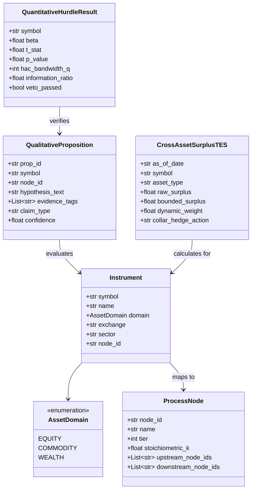

# 数据模型：020-all-in-one-multi-asset-synthesis
# 全域多资产因果量化投研中台数据模型契约 (Multi-Asset Domain Models)

**规格**：`specs/020-all-in-one-multi-asset-synthesis/spec.md`  
**日期**：2026-09-30  
**状态**：完成 (Resolved)  

---

## 1. 实体图谱与层次结构 (Entity Relationship Diagram)

---

## 2. 核心实体规范 (Core Entity Specifications)

### 2.1 标的资产定义 (`Instrument`)
- `symbol` (str): 资产全局唯一代码。如 A 股 `600328.SH`、`000683.SZ`，郑商所期货 `SA0.CZCE`、`FG0.CZCE`。
- `name` (str): 中文标准全称。如 `远兴能源`、`中盐化工`、`纯碱连续`、`玻璃连续`。
- `domain` (`AssetDomain`): 资产赛道枚举（`EQUITY` / `COMMODITY` / `WEALTH`）。
- `exchange` (str): 交易市场标识（`SSE`, `SZSE`, `CZCE`, `SHFE` 等）。
- `sector` (str): 产业大类（如 `存储芯片`、`新能源`、`纯碱玻璃产业链`、`高股息大盘`）。
- `node_id` (str, 可选): 关联的产业链物理工艺节点 ID。

### 2.2 物理因果工艺节点 (`ProcessNode` - 继承 ADR-0002)
- `node_id` (str): 节点唯一代码（如 `NODE_01_TRONA` 天然碱开采、`NODE_02_SODA_SYN` 联碱与氨碱、`NODE_04_FLOAT_GLASS` 浮法玻璃、`NODE_07_END_MODULE` 终端光伏组件）。
- `tier` (int): 产业链层级（1: 原材料采选, 2: 中游化工合成, 3: 工业成型加工, 4: 终端战略需求）。
- `stoichiometric_k` (float): 化学计量/工艺转换系数。例：生产 1 吨浮法玻璃严格消耗 0.20 吨纯碱（$k=0.20$）。
- `upstream_node_ids` (List[str]): 上游成本驱动节点。
- `downstream_node_ids` (List[str]): 下游需求拉动节点。

### 2.3 定性事实命题实体 (`QualitativeProposition` - 继承 ADR-0001)
- `prop_id` (str): 命题唯一 ID。
- `hypothesis_text` (str): 由 LLM 依据产业动态生成的定性假说。**严禁包含数值 Alpha**。
- `evidence_tags` (List[str]): 证据标签集合，必须包含 `[FACT]`、`[OPINION]`、`[INFERENCE]`。**若无 `[FACT]` 标签，直接被代码门禁一票否决**。

### 2.4 定量检验与一票否决结果 (`QuantitativeHurdleResult`)
- `beta` (float): Fama-MacBeth 截面回归系数。
- `t_stat` (float): 采用 Newey-West HAC 稳健标准误修正后的 t 统计量。
- `hac_bandwidth_q` (int): 自适应 HAC 滞后阶数 $q = \max(1, \lfloor 4(T/100)^{2/9} \rfloor)$。
- `p_value` (float): 双侧检验显著性水平。
- `information_ratio` (float): 残差信息比率 $IR = \frac{\bar{\alpha}}{\sigma(\varepsilon)}$（含 $\sigma \le 10^{-9}$ 除零保护）。
- `veto_passed` (bool): 双重门禁决策：`p_value < 0.05 and information_ratio >= 0.30`。

### 2.5 跨资产期望盈余实体 (`CrossAssetSurplusTES` - 继承 v3.1 TES)
- `as_of_date` (str): 计算基准日期（YYYY-MM-DD）。
- `symbol` (str): 资产代码。
- `asset_type` (str): `COMMODITY_FUTURES` 或 `EQUITY_STOCK`。
- `raw_surplus` (float): 原始跨期现与产业毛盈余率。
- `bounded_surplus` (float): 经过双曲正切或 Sigmoid 压缩在 $[-0.30, +0.30]$ 的稳健期望盈余。
- `dynamic_weight` (float): 组合建议配置权重（$0.0 \sim 1.0$）。
- `collar_hedge_action` (str): 极星交易端期权领子（Collar）动作（如 `BUY_PUT_SELL_CALL` / `HOLD`）。

---

## 3. 存储与序列化契约 (Storage Contracts)

1. **A 股权益核心快照**：
   - `docs/data/quantitative/`：`performance.json`, `benchmark.json`, `manifest.json`, `market_temperature.json`。
   - `watchlist.csv`：202 只 A 股高景气核心股票池（存储周期、黄金杠铃、新能源龙头）。
2. **大宗期现产业链快照**：
   - `docs/data/commodity/`：`ranking_cross_asset.json`, `basis_history.json`, `warehouse_receipts.json`。
   - `02_极星量化与实盘/logs/ranking_cross_asset.json`：极星 19.5 专用行情互通接口。
3. **普惠财富快照**：
   - `docs/data/wealth/`：`home_snapshot.json`（适老配置环图、健康晴雨表、安心绝对收益曲线）。
