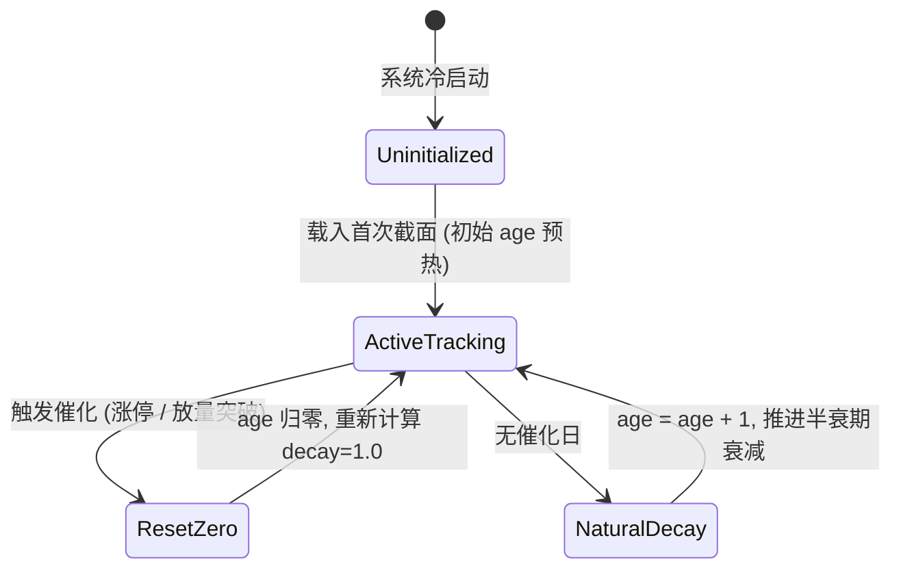

# 数据模型设计：NALE 时效动态连续卷积与事件感知双波峰原型 (data-model.md)

**功能**：`022-refined-temporal-nale`  
**工件目录**：`specs/022-refined-temporal-nale/`  

---

## 1. 实体定义 (Entities)

### 1.1 `NodeEventState`（单节点事件催化与时效年龄实体）
记录单只股票在指定交易日 $t$ 处的最新催化历史与信息陈旧度：

| 字段名 | 类型 | 说明 | 校验规则 |
| :--- | :--- | :--- | :--- |
| `code` | `str` | 6 位股票代码 | 正则 `^[0-9]{6}$` |
| `current_date` | `str` | 当前交易日 | ISO 日期 `YYYY-MM-DD` |
| `age_days` | `float` | 距最近一次催化事件流逝的交易日数 | $0.0 \le \text{age} \le 60.0$ |
| `last_catalyst_type` | `str` | 最近触发的催化事件类型 | 枚举：`limit_up`, `volume_surge`, `steady_decay` |
| `last_catalyst_date`| `str` | 最近一次催化发生日期 | ISO 日期 $\le \text{current\_date}$ |
| `decay_factor` | `float` | 本地动能指数半衰期衰减系数 $\kappa(t)$ | $0.0 < \kappa \le 1.0$ |

---

### 1.2 `LearnedTemporalParameters`（时空连续核拟合参数集）
滚动 Walk-Forward 拟合产出的最优时空连续高斯核与时变耦合参数：

| 字段名 | 类型 | 说明 | 约束范围 |
| :--- | :--- | :--- | :--- |
| `window_id` | `str` | 走步窗口标识 | 如 `WF_2025Q1` |
| `train_start` | `str` | 训练集起始交易日 | ISO 日期 |
| `train_end` | `str` | 训练集截止交易日 (Fit Cutoff) | ISO 日期 |
| `tau_days` | `float` | 产业链物理传导时滞均值 $\tau^*$ | $[6.0, 25.0]$ |
| `sigma_days` | `float` | 高斯共振波峰带宽 $\sigma^*$ | $[2.0, 8.0]$ |
| `alpha_sentiment` | `float` | 早期情绪冲击扩散权重 | $[0.10, 0.45]$ |
| `alpha_physical` | `float` | 物理订单到货共振扩散权重 | $[0.10, 0.45]$ |
| `alpha_base` | `float` | 平稳期背景协同底仓权重 | 默认固定 0.15 |
| `train_rank_ic` | `float` | 训练集内拟合达成的 5 日 Rank IC | 实数，通常 $[0.03, 0.15]$ |
| `converged` | `bool` | L-BFGS-B 优化器是否收敛 | 必须为 `True` |

---

### 1.3 `AblationStepResult`（截面单步消融与对比评测结果）
每个截面评估点输出的四个对比版本的得分与前瞻收益对应关系：

| 字段名 | 类型 | 说明 |
| :--- | :--- | :--- |
| `eval_date` | `str` | 评估交易日 (t) |
| `horizon_days` | `int` | 前瞻预测天数 (如 5d, 10d) |
| `ic_version_a` | `float` | Version A (经典静态 NALE) Rank IC |
| `ic_version_b` | `float` | Version B (硬编码 T-NALE) Rank IC |
| `ic_version_c` | `float` | Version C (启发式动态 Alpha) Rank IC |
| `ic_version_d` | `float` | Version D (事件感知自适应 T-NALE) Rank IC |
| `ic_lift_pct` | `float` | Version D 相对 Version A 的 Rank IC 相对提升率 |
| `top_decile_spread` | `float` | Version D Top 10% 多头超额收益 |

---

## 2. 状态机流转 (State Transition: `EventAgeTracker`)

